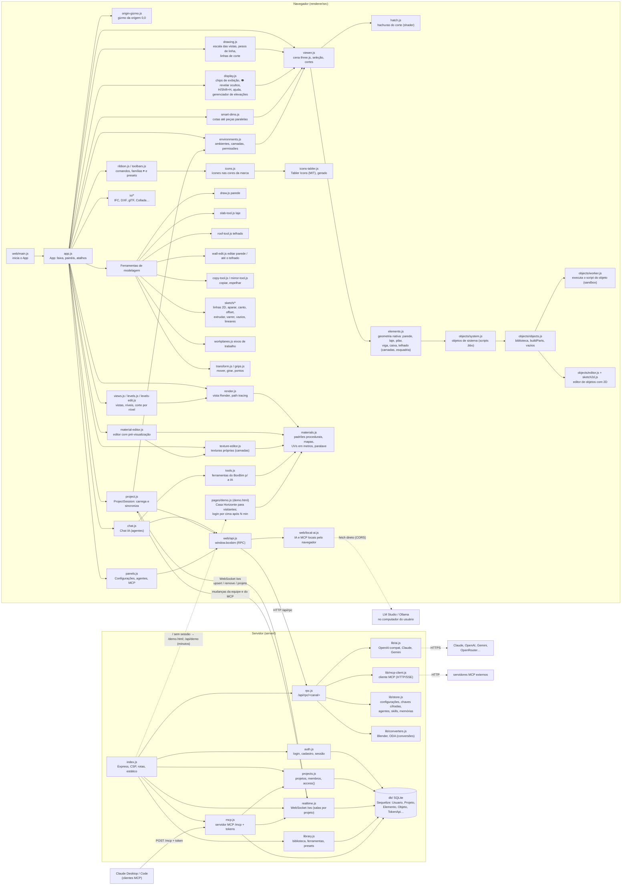

# BoxBim — AGENT.MD (histórico e mapa do projeto)

Documento de referência para quem (pessoa ou agente de IA) vai trabalhar no BoxBim: como a aplicação se liga por
dentro e o histórico de cada commit. **Atualize a cada commit** (regra do `CLAUDE.md`).

## Mapa da arquitetura

O BoxBim é uma aplicação web: o **navegador** modela (three.js) e o **servidor** Node (Express + Sequelize/SQLite)
guarda os projetos, sincroniza a equipe em tempo real (WebSocket), executa conversões e fala com a IA e com o MCP.

### Fluxos principais
- **Modelar**: ferramenta (ex.: `draw.js`) → `createOnLevel`/`elements.js` cria o elemento → `viewer.add` →
  `viewer.changed` → `project.js` envia `upsert` pelo `/ws` → `realtime.js` grava (`Elemento`) e repassa à equipe.
- **Objeto de sistema**: `rebuildElement` (nativo, imediato) → `system.build` roda o script do `.bbo` no
  `worker.js` → `buildParts` → malhas por camada (com esquadria, vãos, perfil próprio).
- **Chat IA**: `chat.js` → `B.ai.chat` → `rpc.js` → `lib/ai.js` (ou `local-ai.js` no navegador, quando a IA é
  local e o servidor está na nuvem) → chamadas de ferramenta → `tools.js` (BoxBim) ou `B.mcp.call` (MCP).
- **MCP (servidor)**: cliente MCP → `POST /mcp` (token) → `mcp.js` → banco + `realtime.notify` → aparece ao vivo.

## Commits

| Data | Versão | Hash | Resumo |
|---|---|---|---|
| 2026-10-23 | 2.14.0 | `c75dead` | Estado inicial do repositório (BoxBim web: modelagem, níveis, objetos, IA, Copiar, Telhado…) |
| 2026-10-23 | 2.14.1 | `1ed8e0e` | Pronto para VPS: Dockerfile, DEPLOY.md, `/api/saude`, `BOXBIM_PROXY/REMOTO/CODIGO_CADASTRO`; regra de commit |
| 2026-10-23 | 2.15.0 | `ac0a483` | Espelhar por uma linha (2D/3D), parede até o telhado, editor de parede com perfil (clique duplo) |
| 2026-10-23 | 2.15.0 | `f359b44` | DEPLOY.md: branch `main` |
| 2026-10-26 | 2.16.0 | `9a6ecb0` | IA local pelo navegador na VPS (LM Studio/Ollama); BoxBim como servidor MCP; Chat IA usando MCP externos |
| 2026-10-26 | 2.16.1 | `98b322e` | Regras do projeto (modelo de commit, AGENT.MD, créditos), créditos na lateral direita e na documentação, AGENT.MD |
| 2026-10-26 | 2.17.0 | `2deab17` | Retirada a conexão com o Unreal Engine; na nuvem o app não consulta mais o Revit (403); CSP corrigido |
| 2026-10-26 | 2.18.0 | `32edf3b` | Ambientes e camadas (`environments.js`); permissão por camada por participante, conferida no tempo real e no MCP |
| 2026-10-26 | 2.19.0 | `7b77756` | Sistema de materiais com mapas procedurais (`materials.js`, `material-editor.js`): bump, normal, AO, deslocamento, rugosidade/brilho, metal, especular, opacidade, emissão |
| 2026-10-26 | 2.19.1 | `edaed46` | Comandos novos (Ambientes, Materiais…) entram sozinhos nos presets de menus já gravados |
| 2026-10-26 | 2.20.0 | `1783e1e` | Estilo de vista Textura (`viewstyle.js` + `RenderMode.enableTextures`): materiais com mapas sem céu/sol/sombras |
| 2026-10-26 | 2.21.0 | `b751611` | Texturas procedurais próprias em camadas (`materials.js`, `texture-editor.js`), gravadas nos tipos do projeto; ferramentas do Chat IA `list_materials`, `create_texture`, `set_material` |
| 2026-10-26 | 2.22.0 | `f9450ed` | Entrada com demonstração (`demo.html` + `pages/demo.js`): Casa Horizonte com materiais procedurais, céu e sol; login por cima depois de `BOXBIM_DEMO_MIN` min |
| 2026-10-26 | 2.23.0 | `5304bfb` | Ferramentas parecidas em botões de família com ▾ (`ribbon.js`, presets convertidos em `toolbars.js`); ícones novos nas cores da marca (`icons.js`) |
| 2026-10-26 | 2.24.0 | `8e71a9e` | Mouse (direito seleciona/janela, Alt+direito gira), visibilidade central e 👁 revelar ocultos (`viewer.js`, `display.js`), cotas até peças paralelas (`smart-dims.js`), elevações próprias com profundidade e largura (`views.js`) |
| 2026-10-26 | 2.25.0 | `bd21d31` | Hospedagem por GUID (vínculo parede ↔ porta/janela sobrevive à reabertura; `repair` religa os antigos) e portas/janelas acompanham a parede (`hosting.follow`); arrastar marcadores de elevação nas plantas (`display.js`) |
| 2026-10-26 | 2.25.1 | `a7229b4` | `hosting.repair` conserta projetos antigos: porta deixada para trás volta para o vão (mesma medida e deslocamento); vão sem porta fecha |
| 2026-10-26 | 2.26.0 | `7aee41c` | Desfazer/refazer geral (`project.js`: passos do envio ao servidor) e botões ↶ ↷ no topo; troca de parede não apaga mais as portas hospedadas |
| 2026-10-26 | 2.27.0 | `5bbf141` | Acabamento visual pela skill high-end-visual-design: páginas (`pages.css`: vidro, moldura dupla, ilha, pílulas, entrada animada) e editor (`styles.css`: janelas, menus, barras, movimento de mola) |
| 2026-10-26 | 2.28.0 | `2fbf1f8` | Ícones genéricos da Tabler Icons (MIT) embutidos (`icons-tabler.js`, gerado por `scripts/gen-tabler-icons.py`); ícones de CAD próprios mantidos; `THIRD-PARTY-NOTICES.md` |
| 2026-10-26 | 2.29.0 | `44b4d48` | Gizmo da origem 0,0 (`origin-gizmo.js`, SVG de tamanho fixo; seta na borda quando fora da tela) |
| 2026-10-26 | 2.30.0 | `1a9f6dd` | Escala por vista e pesos de linha (`drawing.js`); arestas e linhas de corte com espessura real (LineSegments2/LineMaterial; `viewer.updateSectionLines`) |
| 2026-10-26 | 2.31.0 | este commit | Hachura nos materiais (`hatch.js`: padrões, shader da tampa do corte em coordenadas do modelo, prévia no editor) |

---
<a href="https://marceloolimpio.com.br/">BoxHoney By Marcelo Olimpio – Eng. de software v2.31.0</a>
