# BoxBim — AGENT.MD (histórico e mapa do projeto)

Documento de referência para quem (pessoa ou agente de IA) vai trabalhar no BoxBim: como a aplicação se liga por
dentro e o histórico de cada commit. **Atualize a cada commit** (regra do `CLAUDE.md`).

## Mapa da arquitetura

O BoxBim é uma aplicação web: o **navegador** modela (three.js) e o **servidor** Node (Express + Sequelize/SQLite)
guarda os projetos, sincroniza a equipe em tempo real (WebSocket), executa conversões e fala com a IA e com o MCP.

```mermaid
flowchart LR
  subgraph NAV["Navegador (renderer/src)"]
    MAIN["web/main.js<br/>inicia o App"] --> APP["app.js<br/>App: faixa, painéis, atalhos"]
    APP --> VIEWER["viewer.js<br/>cena three.js, seleção, cortes"]
    APP --> DISPLAY["display.js<br/>chips de exibição, 👁 revelar ocultos,<br/>H/Shift+H, ajuda, gerenciador de elevações"]
    APP --> ORIGIN["origin-gizmo.js<br/>gizmo da origem 0,0"]
    APP --> DRAW2D["drawing.js<br/>escala das vistas, pesos de linha,<br/>linhas de corte"]
    DRAW2D --> VIEWER
    VIEWER --> HATCH["hatch.js<br/>hachuras do corte (shader)"]
    APP --> DIMS["dims.js<br/>cotas (objeto, estilos, ferramenta)"]
    DIMS --> VIEWER
    PROJ --> DIMS
    APP --> SDIMS["smart-dims.js<br/>cotas até peças paralelas"]
    DISPLAY --> VIEWER
    SDIMS --> VIEWER
    APP --> VIEWS["views.js / levels.js / levels-edit.js<br/>vistas, níveis, corte por nível"]
    APP --> RIB["ribbon.js / toolbars.js<br/>comandos, famílias ▾ e presets"]
    RIB --> ICONS["icons.js<br/>ícones nas cores da marca"]
    ICONS --> TABLER["icons-tabler.js<br/>Tabler Icons (MIT), gerado"]
    APP --> PANELS["panels.js<br/>Configurações, agentes, MCP"]
    APP --> CHAT["chat.js<br/>Chat IA (agentes)"]
    CHAT --> METER["chat-meter.js<br/>modelo, contexto e tokens"]
    CHAT --> TOOLS["tools.js<br/>ferramentas do BoxBim p/ a IA"]
    APP --> PROJ["project.js<br/>ProjectSession: carrega e sincroniza"]
    APP --> ENVS["environments.js<br/>ambientes, camadas, permissões"]
    ENVS --> VIEWER
    PROJ --> ENVS
    APP --> MODEL["Ferramentas de modelagem"]
    MODEL --> DRAW["draw.js parede"]
    MODEL --> SLAB["slab-tool.js piso"]
    SLAB --> FPTS["floor-points.js<br/>pontos e alturas do piso"]
    FPTS --> ELEM
    SLAB --> FSK["floor-sketch.js<br/>contorno do piso como linhas 2D (clique duplo)"]
    FSK --> FPTS
    FSK --> GDIMS["guide-dims.js<br/>cotas guias arrastáveis"]
    SNAPX["osnap.js<br/>snap ponta, meio, perpendicular"] --> FSK
    SLAB --> FEDIT["floor-edit.js<br/>Editar piso: linhas e furos em planta"]
    FEDIT --> FPTS
    SLAB --> MAPF["geo/map-floor.js + geo/map-view.js<br/>Piso do mapa: área, elevação, textura (MapSkins)"]
    MAPF --> ELEM
    MAPF -->|"/api/mapa/*"| GEOS
    SLAB --> CONT["geo/contours.js<br/>terreno por curvas de nível (DWG/DXF)"]
    CONT --> ELEM
    APP --> ORIENT["geo/orientations.js<br/>norte verdadeiro, orientações, norte por vista"]
    ORIENT --> VIEWS
    PROJ -->|"dados.geo / norte / orientacoes"| ORIENT
    FPTS -->|"slab.arrimo"| RETAIN["retaining.js<br/>muro de arrimo (corte/aterro, lados)"]
    RETAIN --> SLOPES
    FPTS -->|"slab.talude"| SLOPES["slopes.js<br/>talude: corte e aterro com bermas"]
    SLOPES --> CUTS
    FPTS -->|"slab.sobrepor"| DRAPE["drape.js<br/>piso sobreposto acompanha o hospedeiro"]
    DRAPE --> CUTS
    FPTS -->|"slab.rodape"| SKIRT["skirting.js<br/>rodapé com objeto de perfil"]
    FPTS -->|"slab.terreno"| CUTS["sketch/cuts.js<br/>vazios e pisos cortando o terreno (CSG)"]
    MODEL --> ROOF["roof-tool.js telhado"]
    MODEL --> WALLED["wall-edit.js editar parede / até o telhado"]
    MODEL --> COPY["copy-tool.js / mirror-tool.js<br/>copiar, espelhar"]
    MODEL --> SK["sketch/*<br/>linhas 2D, aparar, canto, offset,<br/>extrudar, varrer, vazios, lineares"]
    MODEL --> WP["workplanes.js eixos de trabalho"]
    MODEL --> TRANS["transform.js / grips.js<br/>mover, girar, pontos"]
    VIEWER --> ELEM["elements.js<br/>geometria nativa: parede, piso, pilar,<br/>viga, caixa, telhado (camadas, esquadria,<br/>pontos de altura do piso)"]
    ELEM --> SYS["objects/system.js<br/>objetos de sistema (scripts .bbo)"]
    SYS --> OBJ["objects/objects.js<br/>biblioteca, buildParts, vazios"]
    OBJ --> WORKER["objects/worker.js<br/>executa o script do objeto (sandbox)"]
    OBJ --> EDITOR["objects/editor.js + sketch2d.js<br/>editor de objetos com 2D"]
    APP --> IO["io/*<br/>IFC, DXF, glTF, Collada…"]
    APP --> RENDER["render.js<br/>vista Render, path tracing"]
    RENDER --> MATS["materials.js<br/>padrões procedurais, mapas,<br/>UVs em metros, paralaxe"]
    VIEWS --> RENDER
    APP --> MATED["material-editor.js<br/>editor com pré-visualização"]
    MATED --> MATS
    APP --> TEXED["texture-editor.js<br/>texturas próprias (camadas)"]
    TEXED --> MATS
    MATED --> TEXED
    TOOLS --> MATS
    DEMO["pages/demo.js (demo.html)<br/>Casa Horizonte para visitantes;<br/>login por cima após N min"] --> MATS
    API["web/api.js<br/>window.boxbim (RPC)"] --> LOCALAI["web/local-ai.js<br/>IA e MCP locais pelo navegador"]
    CHAT --> API
    PROJ --> API
    PANELS --> API
  end

  subgraph SRV["Servidor (server/)"]
    IDX["index.js<br/>Express, CSP, rotas, estático"] --> AUTH["auth.js<br/>login, cadastro, sessão"]
    IDX --> PROJS["projects.js<br/>projetos, membros, access()"]
    IDX -. "/ sem sessão → /demo.html; /api/demo (minutos)" .-> DEMO
    IDX --> RPC["rpc.js<br/>/api/rpc/&lt;canal&gt;"]
    IDX --> LIB["library.js<br/>biblioteca, ferramentas, presets"]
    IDX --> MCPS["mcp.js<br/>servidor MCP /mcp + tokens"]
    IDX --> RT["realtime.js<br/>WebSocket /ws (salas por projeto)"]
    IDX --> GEOS["geo.js<br/>/api/mapa: ladrilhos OSM, Sentinel-2, OpenTopoMap,<br/>elevação Terrarium, Nominatim, imagens (cache)"]
    GEOS -. "HTTPS + User-Agent" .-> OPENMAP(["serviços abertos de mapa"])
    RPC --> AI["lib/ai.js<br/>OpenAI-compat, Claude, Gemini"]
    RPC --> MCPC["lib/mcp-client.js<br/>cliente MCP (HTTP/SSE)"]
    RPC --> STORE["lib/store.js<br/>configurações, chaves cifradas,<br/>agentes, skills, memórias"]
    RPC --> CONV["lib/converters.js<br/>Blender, ODA (conversões)"]
    MCPS --> PROJS
    MCPS --> RT
    AUTH --> DB[("db/ SQLite<br/>Sequelize: Usuario, Projeto,<br/>Elemento, Objeto, TokenApi…")]
    PROJS --> DB
    RT --> DB
    LIB --> DB
    MCPS --> DB
  end

  API -- "HTTP /api/rpc" --> RPC
  PROJ -- "WebSocket /ws<br/>upsert / remove / projeto" --> RT
  RT -- "mudanças da equipe e do MCP" --> PROJ
  LOCALAI -. "fetch direto (CORS)" .-> LMS["LM Studio / Ollama<br/>no computador do usuário"]
  AI -. HTTPS .-> CLOUD["Claude, OpenAI, Gemini,<br/>OpenRouter…"]
  MCPC -. HTTP .-> EXTMCP["servidores MCP externos"]
  CLIENTMCP["Claude Desktop / Code<br/>(clientes MCP)"] -- "POST /mcp + token" --> MCPS
```

### Fluxos principais
- **Modelar**: ferramenta (ex.: `draw.js`) → `createOnLevel`/`elements.js` cria o elemento → `viewer.add` →
  `viewer.changed` → `project.js` envia `upsert` pelo `/ws` → `realtime.js` grava (`Elemento`) e repassa à equipe.
- **Objeto de sistema**: `rebuildElement` (nativo, imediato) → `system.build` roda o script do `.bbo` no
  `worker.js` → `buildParts` → malhas por camada (com esquadria, vãos, perfil próprio).
- **Chat IA**: `chat.js` → `B.ai.chat` → `rpc.js` → `lib/ai.js` (ou `local-ai.js` no navegador, quando a IA é
  local e o servidor está na nuvem) → chamadas de ferramenta → `tools.js` (BoxBim) ou `B.mcp.call` (MCP).
- **MCP (servidor)**: cliente MCP → `POST /mcp` (token) → `mcp.js` → banco + `realtime.notify` → aparece ao vivo.

## Commits

| Data | Versão | Hash | Resumo |
|---|---|---|---|
| 2026-10-23 | 2.14.0 | `c75dead` | Estado inicial do repositório (BoxBim web: modelagem, níveis, objetos, IA, Copiar, Telhado…) |
| 2026-10-23 | 2.14.1 | `1ed8e0e` | Pronto para VPS: Dockerfile, DEPLOY.md, `/api/saude`, `BOXBIM_PROXY/REMOTO/CODIGO_CADASTRO`; regra de commit |
| 2026-10-23 | 2.15.0 | `ac0a483` | Espelhar por uma linha (2D/3D), parede até o telhado, editor de parede com perfil (clique duplo) |
| 2026-10-23 | 2.15.0 | `f359b44` | DEPLOY.md: branch `main` |
| 2026-10-26 | 2.16.0 | `9a6ecb0` | IA local pelo navegador na VPS (LM Studio/Ollama); BoxBim como servidor MCP; Chat IA usando MCP externos |
| 2026-10-26 | 2.16.1 | `98b322e` | Regras do projeto (modelo de commit, AGENT.MD, créditos), créditos na lateral direita e na documentação, AGENT.MD |
| 2026-10-26 | 2.17.0 | `2deab17` | Retirada a conexão com o Unreal Engine; na nuvem o app não consulta mais o Revit (403); CSP corrigido |
| 2026-10-26 | 2.18.0 | `32edf3b` | Ambientes e camadas (`environments.js`); permissão por camada por participante, conferida no tempo real e no MCP |
| 2026-10-26 | 2.19.0 | `7b77756` | Sistema de materiais com mapas procedurais (`materials.js`, `material-editor.js`): bump, normal, AO, deslocamento, rugosidade/brilho, metal, especular, opacidade, emissão |
| 2026-10-26 | 2.19.1 | `edaed46` | Comandos novos (Ambientes, Materiais…) entram sozinhos nos presets de menus já gravados |
| 2026-10-26 | 2.20.0 | `1783e1e` | Estilo de vista Textura (`viewstyle.js` + `RenderMode.enableTextures`): materiais com mapas sem céu/sol/sombras |
| 2026-10-26 | 2.21.0 | `b751611` | Texturas procedurais próprias em camadas (`materials.js`, `texture-editor.js`), gravadas nos tipos do projeto; ferramentas do Chat IA `list_materials`, `create_texture`, `set_material` |
| 2026-10-26 | 2.22.0 | `f9450ed` | Entrada com demonstração (`demo.html` + `pages/demo.js`): Casa Horizonte com materiais procedurais, céu e sol; login por cima depois de `BOXBIM_DEMO_MIN` min |
| 2026-10-26 | 2.23.0 | `5304bfb` | Ferramentas parecidas em botões de família com ▾ (`ribbon.js`, presets convertidos em `toolbars.js`); ícones novos nas cores da marca (`icons.js`) |
| 2026-10-26 | 2.24.0 | `8e71a9e` | Mouse (direito seleciona/janela, Alt+direito gira), visibilidade central e 👁 revelar ocultos (`viewer.js`, `display.js`), cotas até peças paralelas (`smart-dims.js`), elevações próprias com profundidade e largura (`views.js`) |
| 2026-10-26 | 2.25.0 | `bd21d31` | Hospedagem por GUID (vínculo parede ↔ porta/janela sobrevive à reabertura; `repair` religa os antigos) e portas/janelas acompanham a parede (`hosting.follow`); arrastar marcadores de elevação nas plantas (`display.js`) |
| 2026-10-26 | 2.25.1 | `a7229b4` | `hosting.repair` conserta projetos antigos: porta deixada para trás volta para o vão (mesma medida e deslocamento); vão sem porta fecha |
| 2026-10-26 | 2.26.0 | `7aee41c` | Desfazer/refazer geral (`project.js`: passos do envio ao servidor) e botões ↶ ↷ no topo; troca de parede não apaga mais as portas hospedadas |
| 2026-10-26 | 2.27.0 | `5bbf141` | Acabamento visual pela skill high-end-visual-design: páginas (`pages.css`: vidro, moldura dupla, ilha, pílulas, entrada animada) e editor (`styles.css`: janelas, menus, barras, movimento de mola) |
| 2026-10-26 | 2.28.0 | `2fbf1f8` | Ícones genéricos da Tabler Icons (MIT) embutidos (`icons-tabler.js`, gerado por `scripts/gen-tabler-icons.py`); ícones de CAD próprios mantidos; `THIRD-PARTY-NOTICES.md` |
| 2026-10-26 | 2.29.0 | `44b4d48` | Gizmo da origem 0,0 (`origin-gizmo.js`, SVG de tamanho fixo; seta na borda quando fora da tela) |
| 2026-10-26 | 2.30.0 | `1a9f6dd` | Escala por vista e pesos de linha (`drawing.js`); arestas e linhas de corte com espessura real (LineSegments2/LineMaterial; `viewer.updateSectionLines`) |
| 2026-10-26 | 2.31.0 | `f8c2e1b` | Hachura nos materiais (`hatch.js`: padrões, shader da tampa do corte em coordenadas do modelo, prévia no editor) |
| 2026-10-26 | 2.32.0 | `8b83af2` | Renomear e duplicar vistas (`views.js`: `names`, `dups`, `dados.vistas`); servidor grava os dados do projeto um por vez (corrige perda de alterações seguidas) |
| 2026-10-26 | 2.33.0 | `ad3d349` | Cotas como objeto (`dims.js`: `bim.cota`, estilos `dados.estilosCota`, ferramenta com encaixe, overlay SVG em mm de papel, propriedades) |
| 2026-10-26 | 2.34.0 | `99879f3` | Medidor do Chat IA (`chat-meter.js`: carregamento do modelo, contexto, tokens; `localModelInfo` consulta LM Studio/Ollama) |
| 2026-10-26 | 2.34.1 | `fc4dab8` | Ícones no Personalizar menus (`toolbars.itemIcon`) |
| 2026-10-27 | 2.35.0 | `bd12f5c` | Ferramenta Terreno (não publicada; retirada na 2.35.1) |
| 2026-10-27 | 2.35.1 | `f71b82c` | Retirada a ferramenta Terreno (revert da 2.35.0) |
| 2026-10-27 | 2.36.0 | `e539b2c` | Laje vira Piso; pontos do piso (arrastar, inserir, apagar, altura, pontos internos de forma) |
| 2026-10-27 | 2.37.0 | `3caead3` | Editar piso (clique duplo): linhas do contorno e furos num editor em planta, como a parede |
| 2026-10-27 | 2.38.0 | `e6a4ac0` | Laje vira Piso em toda a interface (camadas, tipos, IA/MCP) e migração única dos dados gravados |
| 2026-10-27 | 2.39.0 | `6b4670a` | Opção Terreno no piso: só a superfície segue os pontos e os outros pisos cortam o terreno |
| 2026-10-27 | 2.39.1 | `c108a4d` | Unidade do projeto (m/cm/mm) em todas as ferramentas: diálogos, propriedades, objetos, tipos e painéis abertos |
| 2026-10-27 | 2.40.0 | `a9f0409` | Terreno cortado por terreno menor: corte em toda a profundidade e aterro até o fundo |
| 2026-10-27 | 2.41.0 | `c8d2682` | Talude no piso: corte e aterro com proporção, altura das instâncias e distância entre elas |
| 2026-10-27 | 2.42.0 | `b6c7c46` | Suavizar o talude: raio nas quinas do perfil e no encontro com o terreno |
| 2026-10-27 | 2.42.1 | `cc6033a` | Talude sai da aresta do piso (cota real com as alturas dos pontos); malha fina só perto da aresta |
| 2026-10-27 | 2.42.2 | `bc72fc9` | Talude encontra a aresta de cima do piso sem serrilhado (perfil continua para dentro do piso) |
| 2026-10-27 | 2.43.0 | `f472c02` | Edição do piso na tela: medidas dos lados clicáveis e furos com pontos, "+" e medidas |
| 2026-10-27 | 2.44.0 | `9dbe8e0` | Edição 2D do contorno do piso: canto (raio, chanfro, vivo) e offset |
| 2026-10-27 | 2.45.0 | `2a9ea14` | Contorno do piso com linhas 2D (clique duplo) e pontos de elevação com dois cliques pausados |
| 2026-10-27 | 2.46.0 | `c141c7f` | Canto da faixa (vivo, raio, chanfro) direto nos lados do piso |
| 2026-10-27 | 2.46.1 | `2d8b188` | Tirado o bloco Edição 2D do contorno das Propriedades do piso |
| 2026-10-27 | 2.47.0 | `159849d` | Piso sobreposto: acompanha o relevo do piso hospedeiro (escolhido na vista) |
| 2026-10-28 | 2.48.0 | `84abe3e` | Neon no contorno do piso em edição e barras das ferramentas flutuantes e arrastáveis |
| 2026-10-28 | 2.49.0 | `2f3d3a3` | Copiar linhas 2D e arestas de sólidos no contorno do piso; neon fino e rosa |
| 2026-10-28 | 2.49.1 | `d7f1f73` | Ferramentas 2D no plano das linhas do contorno do piso (qualquer cota) |
| 2026-10-28 | 2.50.0 | `c26635e` | Ponteiro próprio em cada ferramenta (cursors.js) e barras flutuantes quadradas e compactas |
| 2026-10-28 | 2.51.0 | `7e4da61` | Copiar contorno (e furos) de outro piso no Editar contorno do piso |
| 2026-10-28 | 2.51.1 | `3376215` | Regra do idioma no CLAUDE.md: sempre em português |
| 2026-10-28 | 2.52.0 | `7a1357c` | Snap do projeto (ponta, meio, perpendicular), cotas guias arrastáveis, offset sem laço, barras verticais |
| 2026-10-28 | 2.52.1 | `c4635c6` | Seleção bloqueada (só as linhas do contorno) durante a edição do piso |
| 2026-10-28 | 2.52.2 | `8e8546e` | Clique seleciona cada linha do contorno (atravessa o bloqueado; linha ganha da superfície) |
| 2026-10-28 | 2.52.3 | `0e4da5d` | Copiar contorno/linhas de um clique: não trava mais as ferramentas da edição do piso |
| 2026-10-28 | 2.53.0 | `e4c2231` | Contorno do piso aberto em vermelho, com X nas pontas soltas |
| 2026-10-28 | 2.54.0 | `6d6faec` | Contorno do piso: solda de pontas (5 mm), T divide a linha, ○ nos cruzamentos e Fechar pontas |
| 2026-10-28 | 2.55.0 | `fa932bd` | Displacement real nos materiais (Render) e rodapé no piso com objeto de perfil |
| 2026-10-28 | 2.56.0 | `bb0e2db` | Material do talude: pele com o material escolhido sobre o corte e o aterro |
| 2026-10-28 | 2.56.1 | `de1ced8` | Opções do Render numa barra inferior encostada no pé da vista |
| 2026-10-28 | 2.57.0 | `24493dd` | Carregando com o ícone do BoxBim enquanto o terreno é recalculado |
| 2026-10-28 | 2.58.0 | `c0124f0` | Prévia do Canto (laranja/amarelo/verde) e ponteiro verde sobre linha válida |
| 2026-10-28 | 2.59.0 | `dc2f757` | Canto arredondado do piso vira uma linha curva única na edição do contorno |
| 2026-10-28 | 2.60.0 | `b44f6e9` | Linhas do sólido copia curvas como arco/círculo único (polylineArcs) |
| 2026-10-28 | 2.60.1 | `368e5e5` | Linhas do sólido: aresta reta subdividida vira um segmento único |
| 2026-10-28 | 2.60.2 | `696a6a3` | Talude: subdivisão por aresta (malha fechada, sem dentes na união com o piso) e malha mais fina junto do contorno |
| 2026-10-28 | 2.61.0 | `908bcb9` | Puxar a linha 2D (grips.js): anda paralela, as ligadas esticam até ela e os arcos vão junto; pontas ligadas acompanham |
| 2026-10-28 | 2.62.0 | `b0414c7` | Terreno 7,2 s → 2,6 s: limite da subdivisão e perfil do talude sem objetos/por ponto, booleano só perto do piso, creaseEdges numérico; recálculo em etapas (cuts.steps/updateAsync) sem travar a página |
| 2026-10-28 | 2.63.0 | `b42e660` | Terreno: barra flutuante "▲ Terreno › ＋ Ponto de altura" nos pontos à mostra (floor-points.js) para pontos no meio do terreno |
| 2026-10-29 | 2.64.0 | `b63bd46` | Etiqueta de nível do piso selecionado com campo de ajuste (floor-points.js); volumes de corte/aterro do talude em m³ (slopeVolumes em slopes.js) |
| 2026-10-29 | 2.65.0 | `47109b4` | Talude: restante (corte − aterro, verde/vermelho), metros da caçamba e total de caminhões; slabKey tira a caçamba das assinaturas; "null" nas propriedades do piso |
| 2026-10-29 | 2.65.1 | `7fe1eaa` | Talude: Total de movimentação (corte + aterro) |
| 2026-10-29 | 2.65.2 | `6d9e645` | Comprimento digitado (grips.setLength → followEnd): a linha ligada acompanha paralela, as do outro lado esticam, arco anda inteiro |
| 2026-10-29 | 2.66.0 | `e8a0e7d` | Arame: viewer.wireOnly (viewstyle.js) — pickHit ignora faces e usa _edgeHits (arestas a ~6 px do raio) |
| 2026-10-29 | 2.67.0 | `1bb808c` | Parede: sem gizmo automático (transform.onSelect); setas cima/baixo/esquerda/direita em grips.js (altura, base, comprimento) |
| 2026-10-29 | 2.68.0 | `5e249d1` | Geolocalização: Piso do mapa (OSM/Sentinel-2/OpenTopoMap, elevação Terrarium, textura), orientações do projeto e norte por vista, terreno por curvas de nível (DWG/DXF); server/geo.js com cache; slabShapeFn em grade e com cache |
| 2026-10-29 | 2.69.0 | `b4ce1d4` | Edição do piso: linha guia tracejada com ângulo (floor-sketch.pickGuide); osnap encaixa na guia e nas interseções |
| 2026-10-29 | 2.70.0 | `8750a12` | Piso: arrimo (retaining.js) — muro por fora dos lados no corte/aterro, lados ligados/desligados na vista; talude não age nos lados com arrimo |
| 2026-10-29 | 2.71.0 | este commit | Puxar linha: ímã em arestas paralelas (grips.magnet/showMagnet), marcador "paralela" |

---
<a href="https://marceloolimpio.com.br/">BoxHoney By Marcelo Olimpio – Eng. de software v2.71.0</a>
